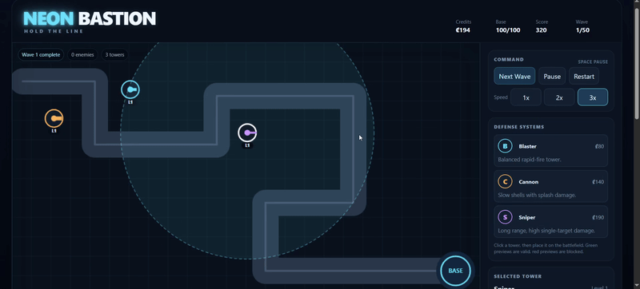

<p align="center">
  
</p>
<p align="center">
  
</p>

# Neon Bastion - Hold the Line

A polished browser-based tower defense game built with **React, JavaScript, Vite, and Canvas 2D**.

## Links

- **Live Game:** https://neon-bastion-v2.vercel.app/
- **Demo Video:** _add the new Loom link after recording_
- **Source Code:** _add the GitHub repository link_
- **Performance Numbers:** [`NUMBERS.md`](./NUMBERS.md)

---

## Requirements covered

- 50 playable waves
- 3 meaningfully different tower types
- 4 meaningfully different enemy types
- Automatic tower targeting and attacks
- Path-following enemies
- Tower placement, upgrades, and selling
- Base health, currency, score, victory, and game over
- Pause, restart, and 1x / 2x / 3x speed controls
- Progressive difficulty
- Browser-only gameplay with no required external runtime service
- Stress workload of exactly **5,000 enemies + 100 towers + 1,000 projectiles**
- One central animation loop rather than one timer/loop per entity

---

# Architecture

```text
React UI
│
├── HUD / score / health / wave
├── Tower shop
├── Upgrade / sell controls
├── Pause / restart / speed controls
├── Performance Lab
└── Victory / game-over overlays
        │
        ▼
GameEngine
│
├── Fixed-step simulation
├── Wave / spawner system
├── Enemy movement
├── Tower targeting
├── Projectile simulation
├── Damage / rewards / scoring
├── Spatial grid
├── Object pools
├── ID Maps
└── Canvas renderer
```

React is responsible for low-frequency interface state. High-frequency entity state stays inside `GameEngine`, so thousands of moving entities are not represented as React components or React state updates.

---

# Rendering approach

The battlefield is rendered with **HTML Canvas 2D**. The interface around it uses React and normal DOM controls.

The renderer uses Canvas 2D for the battlefield and keeps the dynamic entity simulation outside React. The production path avoids a separate full-canvas copy for static scenery because live measurements showed that copying the offscreen layer was not a consistent win on the target browser.

Objects outside the visible canvas region are skipped during dynamic rendering.

---

# Game systems

## Towers

### Blaster
Balanced rapid-fire tower with medium range and fast attacks.

### Cannon
Slow heavy tower with high damage and splash damage.

### Sniper
Long-range tower with very high single-target damage and a slow fire rate.

Each tower can be upgraded to level 3.

## Enemies

### Drone
Balanced baseline enemy.

### Runner
Fast, fragile enemy designed to punish weak coverage.

### Tank
Slow, high-health enemy that deals more base damage.

### Armored
Durable enemy that receives reduced damage.

Enemy composition, health, speed, and count increase as waves progress.

---

# Game loop and state architecture

The engine uses one `requestAnimationFrame()` loop.

Simulation uses a fixed timestep of `1 / 60` second. Real elapsed time is accumulated and consumed in fixed simulation steps, which keeps gameplay behavior consistent across refresh rates.

React receives lightweight snapshots approximately every 100ms instead of receiving every entity position every rendered frame.

---

# Performance investigation

The assignment stress workload is:

```text
5,000 active enemies
100 active towers
1,000 active projectiles
```

The first iteration exposed a severe performance problem under this workload, reaching roughly the **10-20 FPS range** during the stress test. That made profiling and architecture a core part of the implementation rather than an afterthought.

The current Performance Lab reproduces the required workload and provides short live A/B experiments so the effect of the selected optimizations can be measured in the browser without freezing the game UI.

## Main bottlenecks investigated

### Enemy targeting

A naive implementation could make 100 towers compare against 5,000 enemies, creating approximately 500,000 candidate checks during one complete targeting pass.

### High-frequency allocations

Temporary direction objects in projectile movement created avoidable short-lived allocations.

### Rendering overhead

Canvas drawing was profiled as part of the total frame cost. A cached offscreen scenery layer was tested, but it was not kept as a production optimization because the live measurements did not show a consistent improvement on the target browser.

### Entity churn

Enemy and projectile creation/destruction can create garbage-collection pressure. Reusable pools reduce this churn.

### UI work

Thousands of moving entities should not be synchronized through React state every frame.

---

# Optimizations

## 1. Spatial grid for target lookup

The map is partitioned into fixed-size cells. Enemies are inserted into the grid each simulation update. A tower queries only nearby cells instead of scanning all 5,000 enemies.

The Performance Lab measures this optimization **OFF and ON against the same 5,000 / 100 / 1,000 workload**.

## 2. Object pooling

Enemies and projectiles are reused through pools. The pool uses a free-item stack so acquisition is O(1) instead of scanning the complete pool for an inactive object.

The Performance Lab measures fresh object allocation against pooled acquire/release operations using the same scale of object churn.

## 3. Direct ID lookup

Enemies and towers are stored in `Map` objects keyed by ID. Projectiles can resolve targets directly without searching the entire entity array.

## 4. Render culling

Dynamic entities outside the visible canvas region are skipped during rendering.

## 5. Cached tower statistics

Derived tower statistics are cached and invalidated only when a tower is upgraded, avoiding repeated object creation during targeting and rendering.

# Performance measurement

The in-game Performance Lab separates two measurements:

- **Frame interval:** time between browser `requestAnimationFrame` callbacks. This is the value used for the assignment's FPS criteria.
- **CPU work:** JavaScript time spent updating and rendering the game during a frame.

The final stress benchmark uses:

```text
2-second warm-up
30-second measurement
```

and checks:

```text
≥45 FPS for at least 95% of measured frames
<5% of measured frames above 33ms
```

The stress harness keeps the required entity counts stable while measuring:

```text
5,000 enemies
100 towers
1,000 projectiles
```

See [`NUMBERS.md`](./NUMBERS.md) for the live A/B experiment results and final benchmark numbers captured for the submission.

---

# Performance Lab

The in-game Performance Lab provides:

- Initial-style baseline benchmark
- Spatial-grid A/B test
- Object-pool A/B test
- Final 30-second benchmark
- Live frame interval and CPU timings
- Exact stress-workload counters

Each A/B experiment loads the same stress dataset, measures the selected operation with the optimization disabled, then repeats it with the optimization enabled.

This makes the performance improvements measurable rather than relying only on a single final number.

---

# Controls

| Input | Action |
|---|---|
| Click tower card | Select tower type |
| Click battlefield | Place selected tower |
| Click existing tower | Select tower |
| ESC | Cancel placement / clear selection |
| SPACE | Pause / resume |
| 1x / 2x / 3x | Change game speed |

---

# Project structure

```text
neon-bastion/
├── public/
│   ├── favicon.ico
│   ├── neon-bastion-banner.png
│   └── neon-bastion.gif
│
├── src/
│   ├── main.jsx
│   ├── App.jsx
│   ├── index.css
│   │
│   └── game/
│       ├── GameEngine.js
│       ├── ObjectPool.js
│       ├── SpatialGrid.js
│       ├── data.js
│       ├── entities.js
│       └── utils.js
│
├── NUMBERS.md
├── README.md
├── package.json
├── package-lock.json
├── vite.config.js
└── .gitignore
```

---

# Local development

```bash
npm install
npm run dev
```

For a production build:

```bash
npm run build
npm run preview
```

---

# Deployment

The game is a Vite client-side application and can be deployed directly to Vercel.

Recommended Vercel settings:

```text
Framework Preset: Vite
Build Command: npm run build
Output Directory: dist
Install Command: npm install
```

The generated `dist/` directory is intentionally ignored by Git because the deployment platform builds it from source.

---

# AI usage

AI tools were used during development as coding and debugging assistants. The important design decisions were reviewed and validated through implementation, profiling, and live browser tests.

The optimization work was driven by measured bottlenecks rather than blindly applying generated code.

---

# Submission checklist

- [ ] Live Vercel URL opens correctly
- [ ] New Loom video shows face visibly throughout the demo
- [ ] First 30 seconds show a real before/after optimization in action
- [ ] Video explains the performance investigation and experiments
- [ ] Video shows the final 5,000 / 100 / 1,000 stress workload
- [ ] `NUMBERS.md` contains measured before/after values
- [ ] README contains the final Loom URL
- [ ] README contains the final GitHub URL
- [ ] Submission form is submitted before the deadline
