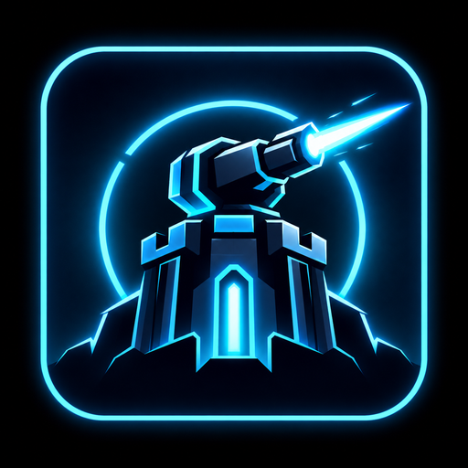
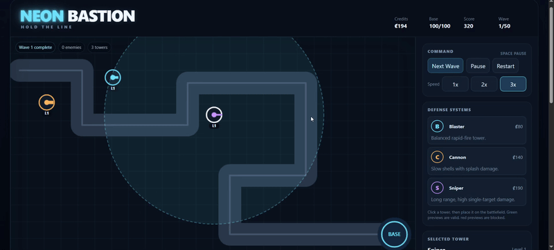

<p align="center">
  
</p>
<p align="center">
  
</p>

# Neon Bastion - Hold the Line

A polished browser-based tower defense game built with **React, JavaScript, CSS, and Canvas 2D**.

## Links

- **Live Game:** https://neon-bastion-v2.vercel.app/
- **Performance Numbers:** [`NUMBERS.md`](./NUMBERS.md)

---

# Game Features

- 50 playable waves
- 3 meaningfully different tower types
- 4 meaningfully different enemy types
- Automatic tower targeting and attacks
- Path-following enemies
- Tower placement, upgrades, and selling
- Base health, currency, score, victory, and game over
- Pause, restart, and 1x / 2x / 3x speed controls
- Progressive difficulty
- Browser-only gameplay with no required external runtime service
- Stress workload of exactly **5,000 enemies + 100 towers + 1,000 projectiles**
- One central animation loop rather than one timer/loop per entity

---

# Architecture

The game is divided into two main parts:

```text
React
│
├── HUD
├── Tower Shop
├── Tower Upgrade / Sell UI
├── Pause / Restart Controls
├── Performance UI
└── Victory / Game Over Screens
        │
        ↓
Game Engine
│
├── Game Loop
├── Enemy System
├── Tower System
├── Projectile System
├── Wave System
├── Collision / Damage
├── Object Pools
├── Spatial Grid
└── Canvas Renderer
```

## React

React is responsible for the user interface only.

It handles:

Game HUD, Currency, Base health, Score, Wave information, Tower selection, Tower upgrade and selling controls, Pause/restart controls, Game speed controls, Victory and game-over screens, Performance benchmark information etc.

The individual enemies, towers and projectiles are **not represented as React components or React state**.

## Game Engine

The `GameEngine` class contains the actual simulation.

It manages:

Enemy movement, Tower targeting, Projectile movement, Damage, Wave progression, Tower placement, Tower upgrades, Tower selling, Player health, Currency, Score, Object pools, Spatial indexing, Rendering etc.

The game engine runs independently of React and sends React only a lightweight snapshot containing information required by the UI.

Rendering Approach

The game uses the **HTML5 Canvas 2D API** for rendering the game world.

React is used around the Canvas for the interface.

This creates a clean separation.

Using thousands of DOM elements or React components for moving entities would introduce unnecessary overhead.

---

# Game systems

## Towers

### Blaster

Balanced rapid-fire tower with medium range and fast attacks.

### Cannon

Slow heavy tower with high damage and splash damage.

### Sniper

Long-range tower with very high single-target damage and a slow fire rate.

Each tower can be upgraded to level 3.

## Enemies

### Drone

Balanced baseline enemy.

### Runner

Fast, fragile enemy designed to punish weak coverage.

### Tank

Slow, high-health enemy that deals more base damage.

### Armored

Durable enemy that receives reduced damage.

Enemy composition, health, speed, and count increase as waves progress.

---

# Game loop and state architecture

The engine uses one `requestAnimationFrame()` loop.

Simulation uses a fixed timestep of `1 / 60` second. Real elapsed time is accumulated and consumed in fixed simulation steps, which keeps gameplay behavior consistent across refresh rates.

React receives lightweight snapshots approximately every 100ms during gameplay. During benchmarks, snapshots are reduced to once per second so the countdown and progress remain visible without causing unnecessary UI commits.

---

# Performance investigation

The assignment stress workload is:

```text
5,000 active enemies
100 active towers
1,000 active projectiles
```

The first iteration exposed a severe performance problem under this workload, reaching roughly the **10-20 FPS range** during the stress test. That made profiling and architecture a core part of the implementation rather than an afterthought.

The Performance Lab sits below the game, leaving the right sidebar dedicated to gameplay controls. Starting a test automatically scrolls the battlefield into view before warm-up begins. Measurements pause if the canvas leaves the viewport or the browser tab is hidden, then restart the warm-up when the game is visible again.

## Main bottlenecks investigated

### Enemy targeting

A naive implementation could make 100 towers compare against 5,000 enemies, creating approximately 500,000 candidate checks during one complete targeting pass.

### High-frequency allocations

Temporary direction objects in projectile movement created avoidable short-lived allocations.

### Rendering overhead

The visible battlefield includes a Canvas scene plus small DOM status badges. A translucent `backdrop-filter` over an actively changing Canvas can force repeated backdrop recompositing. That visual effect is disabled only while benchmarking. During the stress run, the static parts of the 100 tower sprites (platforms, rings, cores, and level badges) are pre-rendered once to an offscreen layer; only their directional barrels are redrawn as targets move. The background grid is drawn as one combined Canvas path rather than dozens of separate strokes. Stress-mode enemy and projectile drawing is batched to reduce Canvas state changes and path work. The renderer displays a lightweight visual sample of enemies, while the complete 5,000-enemy population remains active, simulated, and available to tower targeting. This is a rendering-only simplification; it does not reduce the simulated workload. The full-scene bitmap cache remains disabled because previous live measurements did not show a consistent benefit.

### Entity churn

Enemy and projectile creation/destruction can create garbage-collection pressure. Reusable pools reduce this churn.

### UI work

Thousands of moving entities should not be synchronized through React state every frame.

---

# Optimizations

## 1. Spatial grid for target lookup

The map is partitioned into fixed-size cells. Enemies are inserted into the grid each simulation update. A tower queries only nearby cells instead of scanning all 5,000 enemies. Towers also validate their current target against the tower's attack radius every simulation step. A dead or out-of-range target is cleared immediately, so the barrel and targeting beam do not keep tracking an enemy the tower cannot attack.

The Performance Lab measures this optimization **OFF and ON against the same 5,000 / 100 / 1,000 workload**.

## 2. Object pooling

Enemies and projectiles are reused through pools. The pool uses a free-item stack so acquisition is O(1) instead of scanning the complete pool for an inactive object.

The Performance Lab measures fresh object allocation against pooled acquire/release operations using the same scale of object churn.

## 3. Direct ID lookup

Enemies and towers are stored in `Map` objects keyed by ID. Projectiles can resolve targets directly without searching the entire entity array.

## 4. Render culling

Dynamic entities outside the visible canvas region are skipped during rendering.

## 5. Static stress-tower layer

The stress layout contains 100 stationary towers. Their platforms, rings, cores, and level badges are rendered once to a reusable offscreen layer. Only the moving barrels are drawn each frame. This removes repeated text and static-shape drawing from the visible stress render path.

## 6. Batched background grid

The map grid is assembled into one Canvas path and stroked once per frame rather than issuing a separate path/stroke for every grid line.

## 7. Cached tower statistics

Derived tower statistics are cached and invalidated only when a tower is upgraded, avoiding repeated object creation during targeting and rendering.

# Performance measurement

The in-game Performance Lab separates two measurements:

- **Frame interval:** time between browser `requestAnimationFrame` callbacks. This is the value used for the assignment's FPS criteria.
- **CPU work:** JavaScript time spent updating and rendering the game during a frame.

The 20-second benchmark clock uses the actual elapsed time between animation-frame callbacks. The simulation itself still caps the per-step elapsed delta to avoid large catch-up updates after a stall. Path-segment unit vectors are precomputed, so enemy movement avoids repeating a square-root and vector normalization for every enemy on every fixed update. During benchmarking, the normal rolling-FPS ring buffer is skipped because the benchmark maintains its own frame counters. Spatial-grid insertion uses direct cell-index arithmetic for the 5,000 enemy updates.

The final stress benchmark uses:

```text
3-second warm-up
20-second measurement
```

and checks:

```text
≥45 FPS for at least 95% of measured frames
<5% of measured frames above 33ms
```

The stress harness keeps the required entity counts stable while measuring:

```text
5,000 enemies
100 towers
1,000 projectiles
```

The optional before/after checks compare the spatial-grid and object-pool operations used by the game. They run only when started and never add work to normal gameplay. Each check temporarily loads the stress dataset, measures the operation before and after, then returns the game to a fresh state. These isolated CPU microbenchmarks do not scroll the page or run the Canvas renderer, and their lock is released after each run so either comparison can be repeated or followed by the other. They are separate from the viewport-aware final stress benchmark. See [`NUMBERS.md`](./NUMBERS.md) for the recorded optimization and stress-test measurements.

---

# Performance Lab

The in-game Performance Lab is placed below the game so the right sidebar stays focused on gameplay controls. It provides:

- A final 20-second stress benchmark
- Optional spatial-grid and object-pool before/after checks for optimization evidence
- Live frame interval and CPU timings
- Exact stress-workload counters

Starting any benchmark automatically scrolls the canvas into view. A countdown is displayed over the battlefield during warm-up and measurement. Measurements are accepted only while at least 72% of the canvas is visible and the browser tab is active. Visibility is tracked with `IntersectionObserver` rather than a layout read on every animation frame. If the canvas is scrolled away or the tab is hidden, the benchmark pauses and restarts its warm-up when visibility is restored. When a run completes, the page automatically scrolls back down to the result panel.

Each optional before/after experiment loads the same stress dataset, measures the selected operation with the optimization disabled, then repeats it with the optimization enabled. These checks are deliberately separate from the final stress benchmark because they temporarily use the engine to perform isolated measurements.

This makes the performance changes measurable rather than relying only on a single final number.

---

# Controls

| Input                | Action                             |
| -------------------- | ---------------------------------- |
| Click tower card     | Select tower type                  |
| Click battlefield    | Place selected tower               |
| Click existing tower | Select tower                       |
| ESC                  | Cancel placement / clear selection |
| SPACE                | Pause / resume                     |
| 1x / 2x / 3x         | Change game speed                  |

---

# Project structure

```text
neon-bastion/
├── public/
│   ├── favicon.ico
│   ├── neon-bastion-banner.png
│   └── neon-bastion.gif
│
├── src/
│   ├── main.jsx
│   ├── App.jsx
│   ├── index.css
│   │
│   └── game/
│       ├── GameEngine.js
│       ├── ObjectPool.js
│       ├── SpatialGrid.js
│       ├── data.js
│       ├── entities.js
│       └── utils.js
│
├── NUMBERS.md
├── README.md
├── package.json
├── package-lock.json
├── vite.config.js
└── .gitignore
```

---

# Local development

```bash
npm install
npm run dev
```

For a production build:

```bash
npm run build
npm run preview
```

---

# Deployment

The game is a Vite client-side application and can be deployed directly to Vercel.

Recommended Vercel settings:

```text
Framework Preset: Vite
Build Command: npm run build
Output Directory: dist
Install Command: npm install
```

The generated `dist/` directory is intentionally ignored by Git because the deployment platform builds it from source.

---

# AI usage

AI tools were used during development as coding and debugging assistants. The important design decisions were reviewed and validated through implementation, profiling, and live browser tests.

The optimization work was driven by measured bottlenecks rather than blindly applying generated code.
